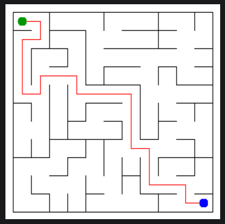

# Assignment 3. Maze Escape

Student ID: 250959
Name: Aizat Kabdyrakmanova
Group: SE-2519
Maze size (rows x columns): 11 x 11

This file is the report. Fill it in as you go. How to start: `START_HERE.md`. The task: `docs/Assignment3.pdf`.

## Program output

The 13 lines your program prints on your data (`java -cp out Main`):

    Broken: 120
    Kept: 100
    Last broken wall: 171
    MST cost: 33375
    Heaviest broken wall: 769
    Path length: 24
    DFS visited: 79
    Dead ends: 39
    Zones: 11
    Largest zone: 18
    Is DAG: 0
    Flow stages: 5
    Fastest route cost: 28

My maze:

## Questions

Answer in your own words, two or three sentences each.

Mission 0. What do find and union do, and what makes them fast in your code?
    `find` returns the root of the set that contains a cell. `union` joins two different sets and returns `false` if the cells are already in the same set. 
    Union by size keeps the trees shallow, and path compression makes later searches faster by connecting visited cells directly to the root.

Mission 1. Why is Broken always R*C - 1, and Kept always (R-1)*(C-1)?
    There are `R*C` cells, and connecting all of them without a cycle makes a tree with `R*C - 1` edges. 
    The grid has `R*(C-1) + C*(R-1)` inner walls, so subtracting the broken walls leaves `(R-1)*(C-1)` walls. 
    For my 11 x 11 maze, this gives 120 broken walls and 100 kept walls.

Mission 2. My MST cost from Kruskal and from Prim, and why they are equal?
    Both algorithms give a total cost of 33375. Kruskal adds the cheapest wall that joins two different components, 
    while Prim adds the cheapest wall that connects a new cell to the growing tree. Both find a minimum spanning tree, so their total costs are equal.

Mission 3. Why is there exactly one path between two cells? How did you avoid a stack overflow on a huge maze?
    The maze is connected and has no cycles, so it is a tree. 
    There is exactly one path between any two cells because two different paths would form a cycle. 
    DFS uses an array as an explicit stack instead of recursive calls, so a long path does not overflow the Java call stack.

Mission 4. Why does the second pass of Kosaraju go on the reversed graph? Why do the slides have no cycle exactly when Zones equals the number of cells?
    The first pass records cells by finishing time, and the second pass processes them in reverse finishing order. 
    Reversing the slides keeps each strongly connected component together and prevents this pass from leaving the current component for an unassigned one. 
    Since the input has no self-loops, a cycle would put at least two cells in one component; therefore, 
    the slides have no cycle exactly when every cell is its own zone.

Mission 5. Why is it enough to go through the zones in the order of their numbers? What does this pass cost?
    Every slide between different zones goes from a smaller zone number to a larger one. 
    When a zone is processed, all its incoming routes have already been considered, 
    so the program can update the longest chain and the cheapest route in one forward pass. With `z` zones and `m` slides, 
    building the lists and processing them takes `O(z + m)` time.a

## AI use
Generally I used ChatGPT to understand the task and explain some theoretical moments, but also to review the code, 
check it against the assignment, explain the maze output

## Timing (Mission 7)

Milliseconds, 5 runs each, from `java -cp out Bench`.

    size    kruskal_ms              (5 runs, then average)     prim_ms                     (5 runs, then average)
    100     21 12 8 21 17               avg 16                 44 20 23 21 17               avg 25
    300     130 118 82 79 67            avg 95                 229 252 191 214 182          avg 214
    1000    1195 1090 1151 1292 1052    avg 1156               3889 3921 4369 3647 4559     avg 4077

    Both algorithms take longer as the number of cells and walls increases. 
    Kruskal is faster than Prim in these runs, especially on the largest maze. 
    The results are consistent with the expected `O(n log n)` growth on a grid.

## Complexity

n is the number of cells, m the number of walls (or slides). Fill in every algorithm you wrote.

| algorithm | time        | space      | assumptions |
|---|-------------|------------|---|
| DSU find and union | O(n)        | O(n)       | Union by size and path compression|
| Kruskal | O(m*log(m)) | O(n+m)     |Sorting walls and using DSU |
| Prim | O(m*log(m)) | O(n+m)     | Priority queue and adjacency lists|
| DFS | O(n)        | O(n)       | Maze is a tree; iterative DFS|
| Kosaraju | O(n+m)      | O(n+m)     | Two DFS passes using stacks|
| Route in the zone graph | O(zones+m)  | O(zones+m) |Zones are in topological order |

## Before you submit

- data/walls.txt, data/slides.txt and output/maze.png are in the repository.
- `java tools/Check.java` shows all examples right.
- This README is filled in, the program output and the section AI use included.
- The work is pushed to main (at least one commit per mission) and the repository is public.
- The link is attached in Moodle.
